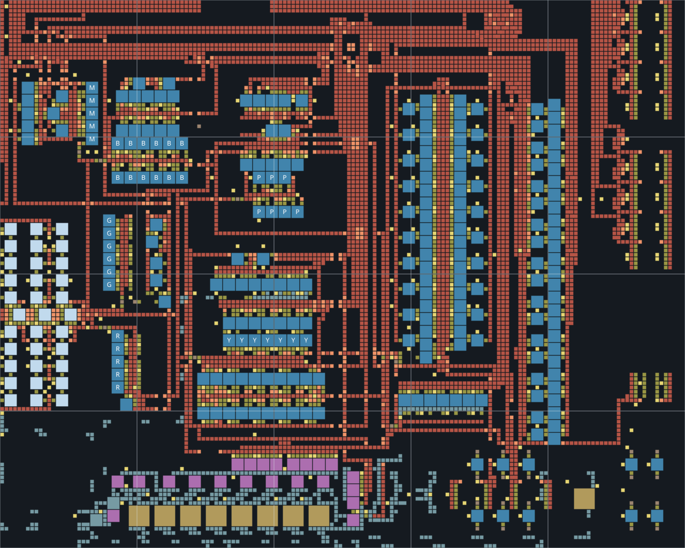

# Brian's Bootstrap — Space Age 2.1

One **160×128** bootstrap reservation, aligned to the 32-tile chunk grid. Red, green, military, blue, purple and yellow science all belong to this factory. Later phases extend the same layout at the same anchor; there is no separate science campus.

[First-launch route and checklist](LAUNCH.md) · [Import string](space-age-bootstrap.txt) · [Connection coordinates](PORTS.md) · [Validation reports](validation/)

This revision targets Factorio 2.1.23 with the official Space Age expansion components and no third-party mods. It replaces the previous development layout. Do not overlay it on that earlier revision: start a fresh placement or move the existing factory deliberately.



The grid lines mark 32-tile chunks. Blue shapes are assemblers, purple shapes are chemical plants, gold shapes are refineries, and pale blue shapes are labs.

## Build phases

Reserve five chunks east–west and four north–south from the beginning. Align every phase to that same chunk intersection. Recipe settings and ghosts do not bypass research prerequisites; build each part as it unlocks.

| Phase | Production | Machines and belts |
|---|---|---|
| 1 | First hand-fed iron/copper smelting | Temporary fuel furnaces inside the reservation |
| 2 | Automation science | Assembler 1s; yellow belts, undergrounds and splitters |
| 3 | Logistic and military science; construction/defense bay | Yellow throughout; add medium power where marked after its green-science unlock |
| 4 | Oil pumping, basic refining and chemical science | Yellow throughout; basic oil works before advanced refining is researched |
| 5 | First-launch research and material stockpiles | Assembler 2s, fast inserters; keep yellow belts; advanced refining/cracking |
| 5b/5c | Launch workshop and first rocket | Separate 32×32 batch workshop, research annex and launch pad; red/green/blue research only |
| 6 — postlaunch | Red-belt upgrade, production and utility science | All six science chains inside the bootstrap; red throughout |
| 7 — optional, later | Belt upgrade after the bootstrap is established | Blue throughout; unnecessary for the 45/min bootstrap |

**Launch first; phase 6 on red belts is the completed postlaunch bootstrap.** See [LAUNCH.md](LAUNCH.md) for research priority, finite ingredient batches, an eight-hour planning budget and the launch procedure. The first-launch path keeps yellow belts through phase 5 to avoid paying for an early whole-factory belt replacement. The blue version and its planner are optional later upgrades. Both tiers produce the same 45 science/min; blue belts should be used when a measured transport bottleneck or space constraint justifies them. Do not delay the first rocket to upgrade the bootstrap to blue.

The ten construction-bay cells produce belts, undergrounds, splitters, inserters, poles, gun turrets, ammunition, walls, repair packs and solar panels. They use ordinary ingredient chests and limited output chests. These are **batch producers**; supply them manually or connect local ingredient belts. They do not require requester chests or continuously divert the science supply. Additional power, rail, concrete, defense and nuclear batch cells are supplied as optional modules.

Apply the provided upgrade planners to existing entities. Placing later ghosts alone does not upgrade built machines. At phase 3, research Electric Energy Distribution 1 using the first green packs, then replace the pole at **(18.5,26.5)** with a medium pole for the military input inserters. The supplied pole planner can be used over that single position. Other poles can remain small. Long-handed inserters retain their reach.

Every phase has one belt tier. Underground connections are at most five tiles long, have both endpoints in the phase, and do not overlap along the same axis. Their connections remain the same when the entire network is changed from yellow to red to blue. Belt tier is never used to separate overlapping tunnels.

## Science and scale

| Science | Assemblers | Assembler 1 capacity/min | Assembler 2 capacity/min |
|---|---:|---:|---:|
| Automation | 5 | 30 | 45 |
| Logistic | 6 | 30 | 45 |
| Military | 5 | 30 | 45 |
| Chemical | 12 | 30 | 45 |
| Production | 7 | — | 45 |
| Utility | 7 | — | 45 |

Purple/yellow machines are added in phase 6, after the assembler-2 upgrade. The complete bootstrap targets **45/min of each science**, without modules or beacons. The 2.1 purple/yellow recipes take 21 seconds, so these counts give exactly 45/min too; the earlier 47.25/min calculation was incorrect. Blue belts add transport capacity; they do not increase crafting speed. An assembler-3/beacon expansion would also need its oil, chemical and intermediate production resized.

Early phases build fewer circuit producers: phase 3 uses two green-circuit assemblers, and phases 4–5 use four green-circuit and twelve red-circuit assemblers. Phase 6 expands those shared production lines to supply purple/yellow as well. The layout avoids constructing a second set of red/green/blue science chains later.

At simultaneous 45/min of all six sciences, normal recipes without productivity need approximately **37.375 iron plates/s, 59.625 copper plates/s, 9.1875 steel/s, 6.25 bricks/s, 3.75 raw stone/s and 10.25 coal/s**. Including steel's iron, this is **83.3125 iron ore/s**. Oil, water and electricity are additional. Coal here is an ingredient, excluding boiler/furnace fuel. Do not size the starter's first smelting cell for the final six-science load.

Producing 1,000 packs at 45/min takes 22 minutes 13 seconds once supply has settled. Build the expensive purple/yellow chains when their research becomes useful, rather than paying for the entire final factory before green science.

The previous starter plus separate campus reserved 39 chunks in total; the main integrated layout reserves 20. The first-launch workshop, research annex and launch pad add one chunk each, for 23 before external supply infrastructure. It uses 5,335 belt/splitter entities, compared with 6,351 across the previous starter plus campus. The old 96×96 starter and its later campus are retained in Git history, not exported alongside the new phases.

## Smelting and raw imports

The first hand-fed furnaces cover the initial milestones, not sustained science. Feed the plate ports from expanding fuel stacks during the early phases. Commission external electric smelting when power and material reserves permit; keep existing external fuel stacks through launch if that saves time. Retire the internal hand-fed cell once external supply is reliable. Ore-processing capacity is expanded outside the bootstrap; science stays inside it.

The electric stacks use the supplied **6×8 EFurnace Tile**, with fast inserters and no advanced-module requests. Interior underground spans are five tiles and use the same belt tier as the rest of the bank.

| Bank | Furnaces | Actual footprint | Chunk reservation | Capacity |
|---|---:|---|---|---|
| Iron/copper/steel | 48 | 40×32 | 64×32 | 30 plates/s or 6 steel/s |
| Stone brick | 24 | 40×16 | 64×32 | 15 bricks/s from 30 stone/s |

Both use one southbound input at **(39.5,0.5)**. Four short furnace rows have westbound outputs **(0.5,6.5), (0.5,14.5), (0.5,22.5), (0.5,30.5)**; the brick bank uses the first two. Keep the row outputs separate or merge them with splitters. Side-loading all four onto one lane would cap it at half a belt. Use iron ore, copper ore, iron plates for steel, or stone for bricks. Furnace recipes select automatically.

The 48-furnace bank uses 8.64 MW of active furnace power; the 24-furnace bank uses 4.32 MW, plus inserters and drain. For the sciences alone, roughly three iron banks, two copper banks, two steel banks and one brick bank provide the required capacity. Mall demand needs additional supply. Install banks progressively.

Connect and power the new stacks before retiring fuel smelting. Phase 5 omits the temporary furnaces; omission does not demolish them. Use the furnace-only deconstruction planner and remove their obsolete chests/inserters manually. Coal then remains for recipe consumers and any backup boilers.

Five resource-specific vanilla **2-2** unloading stations import iron ore, copper ore, coal, stone and crude. The geometry comes from the supplied train reference. Stops have train limit one, and schedules depart the outpost full and the bootstrap empty. Fuel locomotives with coal until you provide automated fuel loading. Connect rail approaches and station outputs manually.

At inserter-capacity bonuses 1–3, the solid unloader measured about **71.7 items/s**, below its three red belts' combined 90/s capacity. The final science iron demand therefore needs parallel unloading or verified later inserter upgrades. Two cargo wagons carry 4,000 ordinary ore; at 83.3 ore/s and a 120-second round trip, allow at least three trains before delays. Travel time is separate from unloading capacity.

The full city-block dispatch overhaul remains the subsequent task.

## Recommended research order

1. **First milestones:** smelt 50 iron plates for Steam Power and 10 copper plates for Electronics. Build external steam power, the first lab and powered mining. Research Automation and Logistics; the phase-2 machines make red science.
2. **Green and military:** Logistic Science Pack, steel, ammunition, walls and turrets as needed. Use the first green packs for Electric Energy Distribution 1 and commission the marked medium pole. Research inserter-capacity bonuses 1–3 as prerequisites allow. The bootstrap assumes enemies may be present. On rail worlds, prioritize Railway, engines and fluid handling during green science when distant deposits require them; the raw-import modules can be commissioned as their prerequisites become available.
3. **Early solar:** prioritize Solar Energy once green science and steel are available. The integrated batch cell makes panels with assembler 1s. Keep steam for nighttime until batteries and accumulators become available. No solar/accumulator field is included.
4. **Oil milestone:** Oil Gathering → power a pumpjack on actual crude → extract oil → Oil Processing. Phase 4 uses basic refining and can make blue science before Advanced Oil Processing. Unlock plastics, sulfur, engines and advanced circuits as needed.
5. **First launch:** follow [the launch research order](LAUNCH.md). Upgrade assembler 1s/inserters with the starter planner, then overlay phase 5, which retains yellow belts. The starter planner now changes machines/inserters only; use the separate yellow→red belt planner after launch. Start workshop ingredients while researching the silo prerequisites. Advanced Material Processing 2 is a research prerequisite; physically converting smelting can wait. Set advanced refining and cracking/lubricant as unlocked.
6. **After launch — infrastructure and later sciences:** apply the separate yellow→red belt planner; then add construction robotics, concrete, accumulator production, flamethrower/laser turret supplies and railway equipment as needed. Add production/utility machines in their reserved positions. Conventional uranium processing can supply nuclear fuel before Kovarex: deliver sulfuric acid to uranium miners, mine actual uranium ore for the Uranium Processing trigger, then run the provided centrifuges and fuel-cell cells.
7. **Postlaunch space handoff:** Space Age's rocket route uses red/green/blue science; purple/yellow and blue transport belts are not rocket prerequisites. Keep yellow belts through the first launch, then red belts through the postlaunch bootstrap. Research Logistics 3 and use the optional blue planner later, when transport demand warrants the cost. Logistics System requires space science. Cliff explosives and artillery require Vulcanus progression and are omitted from these Nauvis modules.

All fluid inputs and working reserves are inside the 160×128 boundary. The main oil section has eight advanced refineries plus one basic refinery for petroleum headroom. Heavy-oil and lubricant working reserves remain 1,000 fluid each; large export-storage buffers are removed. Supply water at **(0.5,97.5)** and crude at **(0.5,99.5)**. See [PORTS.md](PORTS.md) for every plate and fluid port.

## Building and verification

```sh
python3 tools/build-bootstrap.py
python3 tools/fatul.py encode brians-bootstrap/book brians-bootstrap/space-age-bootstrap.txt
python3 -m unittest discover -s tools/bootstrap-tests
```

Native acceptance tests use an official Space Age headless installation:

```sh
python3 tools/check-bootstrap-engine.py --phase 6 --factorio /path/to/factorio
python3 tools/check-bootstrap-engine.py --phase 7 --factorio /path/to/factorio
python3 tools/check-bootstrap-engine.py --scenario support --factorio /path/to/factorio
python3 tools/check-bootstrap-engine.py --scenario launch --timeout 1800 --factorio /path/to/factorio
python3 tools/check-bootstrap-engine.py --scenario research --timeout 1800 --factorio /path/to/factorio
```

**Six-science native result:** both complete red and blue layouts produced 45/min of every science over 18 minutes 40 seconds after an 80-minute cold start. The 36-lab annex researches the silo in 27m49s with finite packs and no research-speed bonus. The finite launch workshop and pad also passed an actual rocket launch and platform-creation test. All 18 structural checks and the native module/import tests pass. See [the validation notes](validation/README.md) for the measurements and their scope.

Reports under `validation/` identify the exact encoded blueprint by SHA-256. Tests supply saturated declared material/fluid ports and external electricity, disable recipe-productivity research, limit inserter capacity to bonuses 1–3, and drain labs to keep demand active. They test the factory's production, not a particular upstream mine/fleet/power design. Support tests check the compact smelters, unloaders, uranium processing, solar production and placement of every phase.

A complete survival playthrough remains unvalidated. Place the revised book in a test world before migrating an existing base. Original source designs and attribution remain in the repository, under its existing license.
