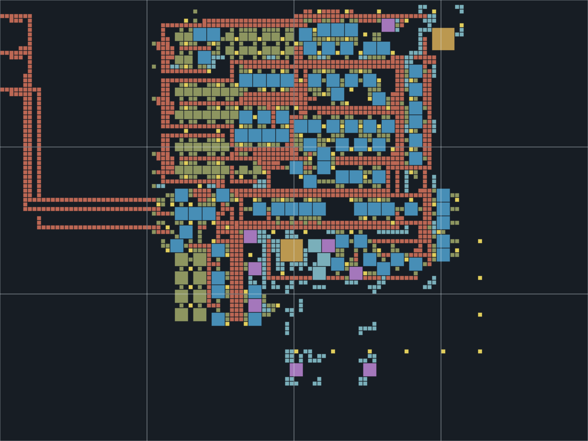

# Original bootstrap rework — development checkpoint

This branch returns to the original bootstrap and retains its mall machinery, recipe positions and main production geometry. It is **not the completed six-science blueprint**. Do not treat the earlier launch-first redesign elsewhere in this branch as the replacement requested here.

Implemented:

- Phase 3 automatically transfers inserters from the original mall output chest to its green-science input, with a routed conveyor connection. The native transport test supplies only that mall chest and verifies inserters arriving inside the green-science assembler. Phase 4 already has its own local automatic inserter-production route.
- Phase 4 adds heavy/light cracking connected to the original water, heavy-oil, light-oil and petroleum networks. The basic refinery and advanced-oil consumers share a real petroleum pipe network, so sulfur can start from basic refining before advanced oil is researched. The original plastic output inserter and basic refinery move slightly to expose those connections. Tank signals enable heavy cracking above 1,000 heavy oil and light cracking above 1,500 light oil; machine inventory reading is disabled so it cannot feed back into its own reserve signal. The native fixture checks actual production at high reserve and no additional crafting below reserve. No fluid deletion is required for balancing.
- Phase 4 uses red belts throughout. The original long red tunnels were not overlapping same-axis belt weaves: upgrading the other belts preserves their existing tunnel pairings. This avoids preserving mixed tiers simply for tunnel reach.
- Phase 5 upgrades assembling machines to assembler 2s, ordinary/burner inserters to fast inserters, small poles to medium poles and stone furnaces to steel furnaces. Long-handed inserters retain their reach. Pipes and other entities without a Nauvis tier-2 equivalent remain their ordinary versions. A matching upgrade planner is included.
- Phase 6 replaces the three isolated iron/copper science furnaces with connected priority imports. Its three west headers send material to science first and expose mall-overflow outlets. Native tests measured 1,800 items/min per science feed, zero overflow while science demanded material, and overflow once science backed up. The outlets still require connection to the player’s main mall/import lines; do not feed plates to ore inlets.
- Finished mall output chests have one-stack bounds and individual circuit stock limits. Locomotives stop at two; one-item output-inserter stack overrides avoid overshooting that limit. Belt-fed gears, circuits and engines are excluded from these finished-product limits.
- `science-demand.json` calculates the complete 45/min six-science material/intermediate demand from the pinned official recipe snapshot. It excludes mall stockpiles. In particular, science requires 22.5 green circuits/s, 4.625 red circuits/s, 1 engine/s and 2.875 gears/s before mall demand.

Phase 4 includes later oil upgrades: commission basic refining/plastic/sulfur first, then advanced refining and cracking as their research unlocks. Pump actual crude to satisfy the oil milestone before commissioning processing.

Still required before release:

1. Finish the main imported-plate/steel and mall-overflow connections. The direct iron/copper science handoff is implemented, but extending allocation through shared gears, circuits and engines and the eventual steel imports remains unfinished.
2. Expand intermediate production to meet the demand report, including material costs for the additional mall stockpiles. Bound each mall's output without restricting intermediates supplying science.
3. Complete and connect the requested 5/6/5/12/7/7 science machines. The current original layout still has 2 red, 2 green and 4 blue machines.
4. Add the remaining concrete, Nauvis turret, electric-furnace and nuclear production to the original integrated mall.
5. Verify all science rates, progression and the integrated plate-import routing in the native engine. The tier-2 fuel furnaces are temporary; external electric smelting and removal of obsolete coal branches remain to be commissioned.

The Phase-3 inserter supply route is temporary once Phase 4's local science inserter production is commissioned. Retire its extra conveyor connection deliberately rather than overlaying both routes where later machinery conflicts. This transition also needs final integration before release.

Rebuild with `python3 tools/build-original-bootstrap.py`. The tested tier-2 phase also verifies controlled cracking, petroleum delivery to the original plastic plant, and a locomotive output buffer stopping at exactly two.

Structural checks run with `python3 -m unittest discover -s tools/bootstrap-tests`. Native route/cracking fixtures use `tools/check-bootstrap-engine.py --scenario original --phase 3` or `--phase 4` with an official Space Age binary. Validation reports describe their actual scope; they are not full-factory throughput or survival-playthrough results.
